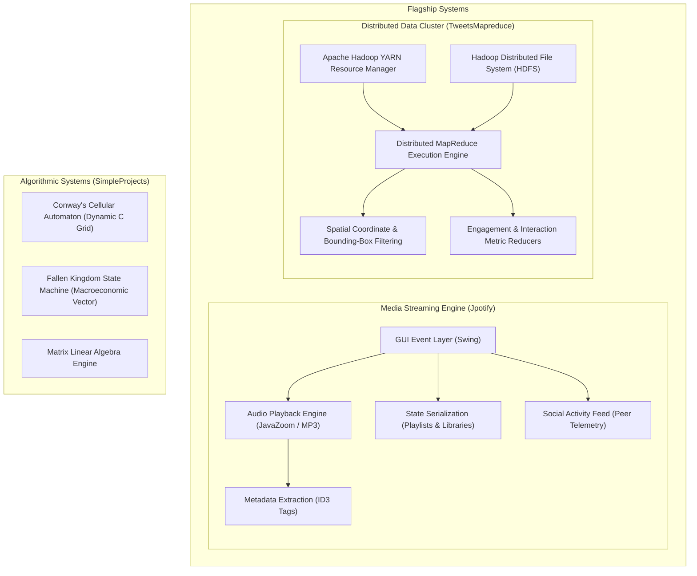

# Media Streaming & Distributed Big Data Processing Systems

A consolidated engineering monorepo focused on large-scale distributed computing, event-driven audio streaming engines, and algorithmic simulation systems. The repository unites two primary flagship architectures: **Jpotify** (an event-driven desktop media player and streaming system in Java) and **TweetsMapreduce** (a multi-node Apache Hadoop YARN cluster executing distributed data processing across large-scale social datasets), alongside supporting algorithmic and state-machine systems.

---

## Repository Architecture & Subtree Structure

```
media-streaming-and-distributed-data-systems/
├── projects/
│   ├── Jpotify/                  # Desktop audio streaming application & playback engine
│   │   ├── AddANewFriend.java    # Social network graph management & peer connection dispatch
│   │   ├── CompleteMp3Player.java# Multi-threaded audio decoding and playback controller
│   │   ├── CentralScreen.java    # Primary GUI container and event orchestration
│   │   ├── PlayList.java         # Dynamic playlist queue management and scheduling
│   │   ├── Song.java             # ID3 audio metadata encapsulation and stream modeling
│   │   ├── UserData.java         # User profile state serialization and library storage
│   │   └── README.md             # Original Jpotify project documentation
│   │
│   ├── TweetsMapreduce/          # Distributed Hadoop YARN cluster & MapReduce analytics
│   │   ├── CountryTweets.java    # Distributed geopolitical aggregation and candidate ratio mapper
│   │   ├── CountryTweetsBySpec.java # Spatial coordinate bounding-box geofiltering reducer
│   │   ├── likeAndRetweet.java   # Lexical engagement counter and metric summarizer
│   │   ├── assets/               # Localized cluster architecture and monitoring telemetry
│   │   │   ├── image_1.png       # NameNode & ResourceManager JPS daemon verification
│   │   │   ├── image_2.png       # Secondary DataNode & NodeManager verification
│   │   │   ├── image_3.png       # Tertiary NodeManager verification
│   │   │   ├── image_4.png       # Apache Hadoop YARN WebGUI cluster overview
│   │   │   ├── image_5.png       # HDFS distributed file system storage metrics
│   │   │   ├── image_6.png       # Active DataNode memory allocation telemetry
│   │   │   └── image_7.png       # Resource manager memory utilization breakdown
│   │   └── README.md             # Full original Hadoop cluster and analysis documentation
│   │
│   └── SimpleProjects/           # Algorithmic simulation engines & domain models
│       ├── FallingKingdom.c      # Macroeconomic state-machine governance simulation in C
│       ├── gameOfLife.c          # Conway's Game of Life with dynamic perimeter grid expansion
│       ├── InternetShop.java     # Transactional retail inventory and accounting engine
│       ├── matrixCalculator.java # Linear algebra engine with dimensional assertions
│       ├── mineGame.java         # Discrete grid 8-connected proximity matrix generator
│       └── README.md             # Subproject documentation
│
├── .gitignore                    # Centralized build and binary exclusion rules
└── README.md                     # Monorepo technical documentation
```

---

## Architectural Systems Overview



---

## Core Engineering Pillars

### 1. Desktop Media Streaming & Audio Architecture (`Jpotify`)
* **Multi-Threaded Audio Pipeline:** Implements a decoupled audio processing and user interface architecture in Java, integrating third-party decoding libraries (`javazoom` and `mp3agic`) to achieve low-latency audio stream playback, pausing, seeking, and dynamic volume normalization.
* **Metadata Extraction & Cataloging:** Parses raw MP3 bitstreams to extract standard ID3 tag metadata, including track titles, contributing artists, album categorization, track durations, and embedded cover art bitmaps.
* **Persistent Library Serialization:** Preserves user library hierarchies, custom playlists, track sequencing, and user profile data through robust binary object serialization protocols, ensuring zero state degradation across application lifecycles.
* **Social Activity Telemetry:** Models an event-driven friend network subsystem capable of dispatching and broadcasting real-time peer listening telemetry and track playback states.

### 2. Distributed Big Data Processing & Hadoop YARN Cluster (`TweetsMapreduce`)
* **Multi-Node Cluster Architecture:** Configured and deployed across a multi-node virtualized cluster running Apache Hadoop on Linux:
  * **Master Node:** Orchestrates HDFS storage coordination as **NameNode** and manages cluster-wide compute scheduling as **ResourceManager**.
  * **Worker Nodes:** Execute distributed storage and localized task processing as **DataNodes** and **NodeManagers**.
* **Distributed Analytics on 172-Million Tweet Corpus:**
  * **Engagement Metric Aggregation:** MapReduce jobs tokenize large-scale social interaction streams to compute aggregate interaction metrics (like and retweet frequencies) across political candidates.
  * **Geospatial & Geopolitical Disambiguation:** Compares explicit geopolitical profile metadata against numerical bounding-box coordinate classification ($[\text{Longitude}_{\min}, \text{Longitude}_{\max}] \times [\text{Latitude}_{\min}, \text{Latitude}_{\max}]$), demonstrating the statistical divergence between self-reported country tags and raw geographical sensor coordinates.
* **Telemetry & Monitoring:** Interfaced with native YARN and HDFS web dashboards to monitor physical cluster metrics, including memory allocation, live DataNode health, and distributed block replication factors.

### 3. Algorithmic Simulation & Discrete State Machines (`SimpleProjects`)
* **Cellular Automata with Dynamic Perimeter Expansion:** ANSI C implementation of John Conway's two-dimensional zero-player cellular automaton. Employs dynamic coordinate reallocation when living cell configurations reach boundary thresholds, eliminating artificial reflective boundary artifacts.
* **Macroeconomic State-Space Strategy Simulation:** Text-based governance simulation tracking normalized 3-dimensional state vectors representing citizenry satisfaction, aristocratic stability, and treasury solvency under stochastic decision trees.

---

## Provenance & Git History

Full commit history from the original source repositories has been preserved using `git subtree`:
- `projects/Jpotify` originating from [Jpotify](https://github.com/MahdiTheGreat/Jpotify)
- `projects/TweetsMapreduce` originating from [TweetsMapreduce](https://github.com/MahdiTheGreat/TweetsMapreduce)
- `projects/SimpleProjects` originating from [SimpleProjects](https://github.com/MahdiTheGreat/SimpleProjects)
